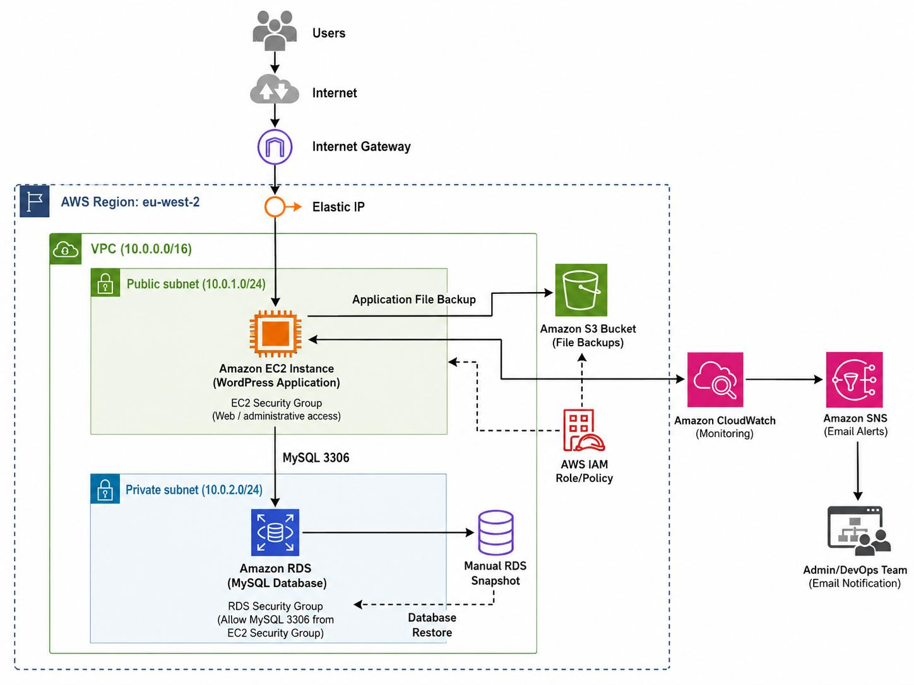

#aws-dr-case-study

Disaster recovery for a small WordPress site on AWS, using the Backup and
Restore strategy. This is the practical part of my MSc Cloud Computing
dissertation (University of East London).

## What I built
- Region eu-west-2 (London). VPC 10.0.0.0/16 with a public subnet (10.0.1.0/24) and a private subnet (10.0.2.0/24)
- WordPress on Amazon EC2, with an Elastic IP
- Amazon RDS for MySQL, with manual RDS snapshots as recovery points
- Amazon S3 for WordPress file backups
- CloudWatch alarm (CPU above 70% for 300 seconds) that sends an email through Amazon SNS
- IAM and security groups for access control

## Architecture

Users reach WordPress on EC2 through an Elastic IP. WordPress talks to an RDS MySQL database in a private subnet. Files are backed up to S3, and a CloudWatch alarm sends email alerts through SNS.

## Tests and results
| Test | What I did | Result |
|------|------------|--------|
| 1. Database recovery | Restored an RDS snapshot as a new instance and reconnected WordPress | About 11 min from restore start to a working site; test post recovered |
| 2. EC2 recovery | Stopped EC2, started it, waited for WordPress | About 10 min active recovery. One run had 19 min total downtime because recovery started late |
| 3. Recovery point | Post before snapshot, post after, then restored | Pre-snapshot post recovered, post-snapshot post absent. RDS restore stage about 6 min |
| 4. Full EC2 + RDS recovery | Restored the database, recovered EC2, fixed the config | About 21 min from failure to a working site |
| 5. Monitoring | Triggered the CloudWatch alarm | Alarm went to ALARM and the SNS email arrived |

Times are observed values from a small number of runs with manually recorded
timestamps. They are not AWS guarantees.

## What I learned
- The full recovery (about 21 min) missed my proposal's 15-minute target by about 6 minutes
- A database showing "Available" does not mean the site works: WordPress had to be pointed at the new RDS endpoint, EC2 had to be healthy, security groups checked, and the web service restarted
- Delay before recovery starts counts as downtime too (19 min vs 10 min in Test 2)
- Manual steps cause delay and human error

## Cost
The AWS estimated bill for August 2026 was USD 4.99 before credits (EC2, RDS and
public IPv4), and USD 0.00 payable after credits. EC2 and RDS were stopped when
not in use, so this is not a production monthly cost.

## Limits
- One small WordPress system, few runs, manual timestamps
- S3 file restore was not tested separately
- Route 53, cross-region failover, load balancing and automation were not implemented

## Future work
- Infrastructure as Code (Terraform or CloudFormation) to rebuild the environment
- Scripted update of the restored RDS endpoint
- A Pilot Light comparison under the same tests
